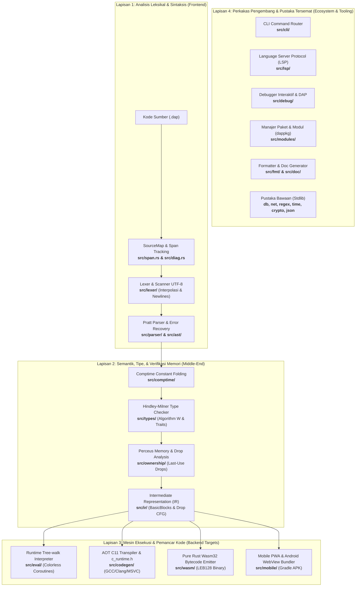
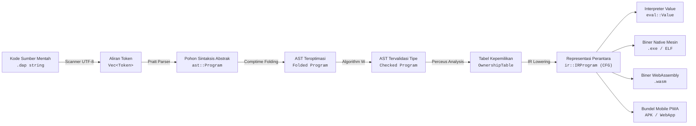
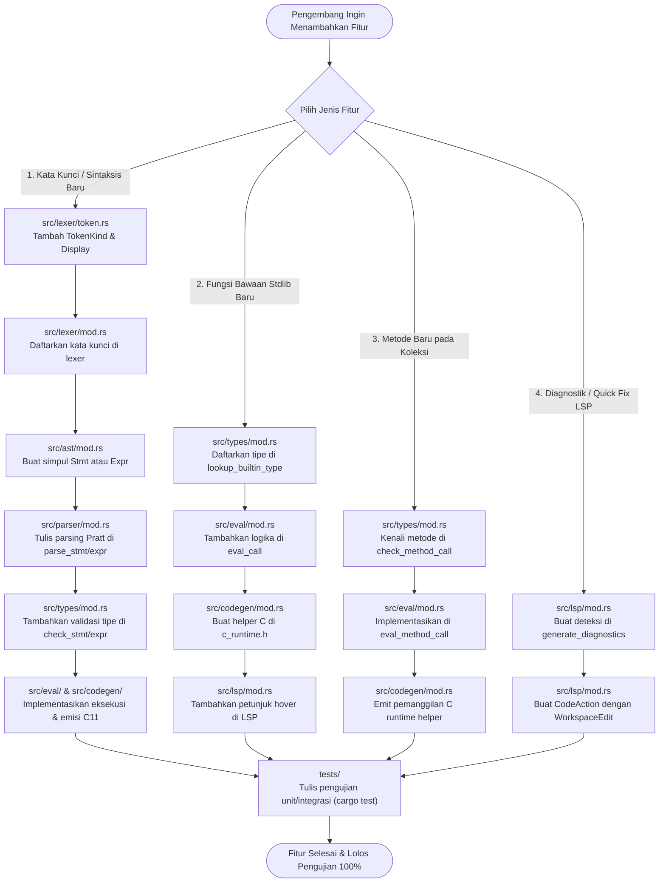
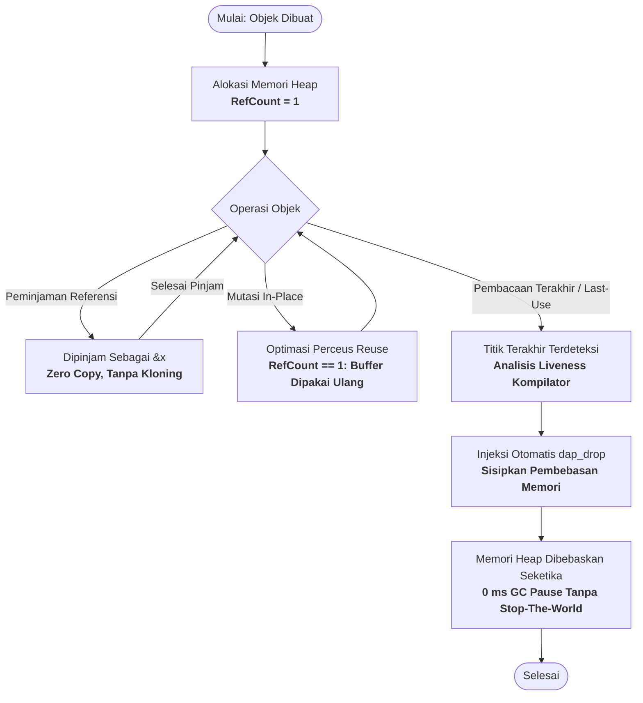

# 🛠️ Panduan Arsitektur & Rekayasa Kompilator DapCode
## *DapCode Language & Compiler Internals Engineering Guide*

Selamat datang di Panduan Resmi Rekayasa Kompilator dan Arsitektur Internal Bahasa Pemrograman **DapCode** (`dapcodec`). Dokumen ini disusun secara komprehensif bagi kontributor, pemelihara (*maintainers*), dan arsitek bahasa untuk memahami struktur kode internal di `src/`, alur kerja pipeline kompilasi, mekanisme sistem tipe dan manajemen memori, hingga tata cara memperluas sintaksis atau pustaka standar bawaan.

Versi HTML interaktif yang dilengkapi pencarian instan, tema visual modern, dan diagram alur dapat diakses langsung melalui:
👉 **[docs/index.html](index.html)** atau perintah terminal: `dapcodec doc --open`.

---

## 📑 Daftar Isi

0. [Peta Visual Arsitektur & Rekayasa Kompilator (Mermaid Maps)](#-peta-visual-arsitektur--rekayasa-kompilator)
1. [Filosofi Desain & Arsitektur Umum](#1-filosofi-desain--arsitektur-umum)
2. [Pipeline Alur Kompilasi End-to-End](#2-pipeline-alur-kompilasi-end-to-end)
3. [Peta & Anatomi Mendalam Modul Internal (`src/`)](#3-peta--anatomi-mendalam-modul-internal-src)
4. [Infrastruktur Dasar: Pelacakan Posisi & Diagnostik (`span.rs` & `diag.rs`)](#4-infrastruktur-dasar-pelacakan-posisi--diagnostik)
5. [Scanner & Lexer: Tokenisasi & Interpolasi String Bersarang (`src/lexer/`)](#5-scanner--lexer-tokenisasi--interpolasi-string-bersarang)
6. [Parser & AST: Algoritma Pratt Parsing & Hirarki Sintaksis (`src/parser/` & `src/ast/`)](#6-parser--ast-algoritma-pratt-parsing--hirarki-sintaksis)
7. [Metaprogramming Waktu Kompilasi: Zig-Style `comptime` (`src/comptime/`)](#7-metaprogramming-waktu-kompilasi-zig-style-comptime)
8. [Sistem Tipe & Inferensi Hindley-Milner (`src/types/`)](#8-sistem-tipe--inferensi-hindley-milner)
9. [Manajemen Memori Deterministik Tanpa GC: Algoritma Perceus (`src/ownership/`)](#9-manajemen-memori-deterministik-tanpa-gc-algoritma-perceus)
10. [Representasi Perantara: Intermediate Representation (`src/ir/`)](#10-representasi-perantara-intermediate-representation)
11. [Empat Target Backend Eksekusi & Bundler](#11-empat-target-backend-eksekusi--bundler)
    - [A. Tree-walk Runtime Interpreter & Concurrency (`src/eval/`)](#a-tree-walk-runtime-interpreter--concurrency)
    - [B. Ahead-Of-Time (AOT) C11 Codegen & Runtime C (`src/codegen/`)](#b-ahead-of-time-aot-c11-codegen--runtime-c)
    - [C. Pure Rust Standalone Wasm32 Bytecode Emitter (`src/wasm/`)](#c-pure-rust-standalone-wasm32-bytecode-emitter)
    - [D. Mobile PWA & Hybrid Android WebView Bundler (`src/mobile/`)](#d-mobile-pwa--hybrid-android-webview-bundler)
12. [Pustaka Standar Bawaan Terintegrasi (*Batteries Included*)](#12-pustaka-standar-bawaan-terintegrasi-batteries-included)
    - [Basis Data Tersemat ACID Mandiri (`src/db/`)](#basis-data-tersemat-acid-mandiri-srcdb)
    - [Server Jaringan HTTP REST & WebSocket RFC 6455 (`src/net/`)](#server-jaringan-http-rest--websocket-rfc-6455-srcnet)
    - [Mesin Reguler Ekspresi Zero-Dependency (`src/regex/`)](#mesin-reguler-ekspresi-zero-dependency-srcregex)
    - [Kalender Sipil & Waktu Presisi Tinggi (`src/time/`)](#kalender-sipil--waktu-presisi-tinggi-srctime)
    - [Kriptografi Standar SHA-256, MD5, Base64 (`src/crypto/`)](#kriptografi-standar-sha-256-md5-base64-srccrypto)
    - [Parser & Serializer JSON Mandiri (`src/json/`)](#parser--serializer-json-mandiri-srcjson)
13. [Ekosistem Perkakas: LSP, Debugger DAP, Formatter, & Generator Dokumen](#13-ekosistem-perkakas-lsp-debugger-dap-formatter--generator-dokumen)
14. [Manajer Paket `dappkg` & Sistem Modul Multi-Berkas (`src/modules/`)](#14-manajer-paket-dappkg--sistem-modul-multi-berkas)
15. [Panduan Langkah-demi-Langkah Pengembang (*Developer Recipes*)](#15-panduan-langkah-demi-langkah-pengembang-developer-recipes)
    - [Resep 1: Menambahkan Kata Kunci / Sintaksis Baru ke Bahasa](#resep-1-menambahkan-kata-kunci--sintaksis-baru-ke-bahasa)
    - [Resep 2: Menambahkan Fungsi Bawaan Baru ke Pustaka Standar](#resep-2-menambahkan-fungsi-bawaan-baru-ke-pustaka-standar)
    - [Resep 3: Menambahkan Metode Baru pada Koleksi Primitif (`Daftar` / `Kamus`)](#resep-3-menambahkan-metode-baru-pada-koleksi-primitif)
    - [Resep 4: Menambahkan Diagnostik Peringatan & Quick Fix Otomatis di LSP](#resep-4-menambahkan-diagnostik-peringatan--quick-fix-otomatis-di-lsp)
16. [Verifikasi Kualitas, Debugging Kompilator, & Rangkaian Pengujian](#16-verifikasi-kualitas-debugging-kompilator--rangkaian-pengujian)

---

## 🗺️ Peta Visual Arsitektur & Rekayasa Kompilator

> [!TIP]
> **Eksplorasi Interaktif Tersedia di Portal Web:**
> Untuk pengalaman eksplorasi interaktif (klik modul untuk membuka *Dynamic Module Inspector*, menjalankan *Live Compiler Pipeline Simulator* langkah-demi-langkah, dan mencentang *Interactive Recipe Checklist*), jalankan perintah:
> ```bash
> dapcodec doc --open
> ```
> atau buka langsung [docs/index.html](file:///d:/dapcode-lang/docs/index.html) di peramban web Anda.

Berikut adalah diagram pemetaan arsitektural terstruktur yang merangkum seluruh subsistem, alur data, hierarki memori, dan alur kontribusi kompilator DapCode:

### Peta 1: Hirarki Lapisan Sistem Kompilator (*System Layering Architecture Map*)
Diagram ini memetakan bagaimana seluruh 30+ modul internal di `src/` dikelompokkan ke dalam 4 lapisan abstraksi:



---

### Peta 2: Alur Transformasi Data Kompilasi (*End-to-End Pipeline Data Flow*)
Diagram ini menggambarkan struktur data yang diproduksi dan ditransformasikan pada setiap lintasan:



---

### Peta 3: Alur Kerja Kontributor / Penambahan Fitur Baru (*Developer Decision Map*)
Gunakan diagram ini sebagai panduan cepat saat Anda ingin menambahkan fitur baru ke dalam kompilator:



---

### Peta 4: Siklus Hidup Memori Deterministik Perceus (*Memory Lifecycle Map*)
Diagram ini mengilustrasikan bagaimana memori dialokasikan, dipinjam, dimutasi in-place, dan dilepaskan seketika tanpa jeda GC:



---

## 1. Filosofi Desain & Arsitektur Umum

DapCode diciptakan untuk memadukan **kinerja native setara C/Rust** dengan **ergonomi ekspresif berbahasa Indonesia**. Dalam perancangannya, kompilator mengadopsi 4 pilar arsitektur utama:

1. **Keamanan Memori Deterministik 100% Tanpa Garbage Collector (GC):**
   - Berbeda dengan Go atau Java yang menggunakan Garbage Collector dengan *stop-the-world pauses*, atau C yang mengandalkan alokasi manual (`malloc`/`free`) yang rawan *memory leak* dan *use-after-free*, DapCode mengadopsi algoritma **Perceus Reference Counting** dengan analisis kepemilikan linier (*affine types*).
   - Kompilator menghitung titik penggunaan terakhir (*last-use*) dari setiap variabel, lalu secara otomatis menyisipkan pelepasan memori (*drop*) deterministik tepat pada saat variabel tidak lagi dibutuhkan.
   - Ketika objek data hanya memiliki hitungan referensi = 1 saat akan dimutasi, DapCode melakukan mutasi langsung di tempat memori lama (*in-place destructive reuse*), menghilangkan alokasi berulang pada operasi string dan koleksi.

2. **Zero Null Pointer Exception & Pemodelan Kesalahan Matematis:**
   - Di DapCode, nilai `null` atau `nil` ditiadakan sama sekali.
   - Seluruh operasi yang berpotensi gagal wajib memodelkan hasilnya sebagai **Error Union** bertipe `T ! E` (contoh: `u64 ! Teks`).
   - Penanganan error dilakukan secara elegan melalui operator propagasi `?` atau blok penangkap `? tangkap err { ... }`.

3. **Sintaksis Alami Bahasa Indonesia yang Bersih & Ergonomis:**
   - Menggantikan kata kunci konvensional dengan ekspresi bahasa Indonesia yang lugas (`fungsi`, `jika`, `selain_itu`, `selama`, `untuk`, `struktur`, `sifat`, `terapkan`, `kembali`, `gagal`, `tangkap`, `uji`, `comptime`, `jalan_paralel`, `tunggu`).
   - Menggunakan deklarasi ringkas `:=` (*walrus operator*) dengan inferensi tipe otomatis tanpa boilerplate.

4. **Kompilasi Multi-Target Tanpa Ketergantungan Eksternal (*Zero-Dependency Toolchain*):**
   - Kompilator DapCode ditulis murni dalam bahasa Rust standar dan menghasilkan 4 target sekaligus:
     1. *Interpreter Cepat*: Eksekusi langsung tanpa waktu kompilasi untuk pengembangan harian (`dapcodec run`).
     2. *AOT C11 Transpiler*: Menghasilkan kode C11 ISO standar untuk biner berekspresi penuh dengan optimasi GCC/Clang/MSVC (`dapcodec build`).
     3. *Standalone Wasm32 Emitter*: Mengompilasi kode menjadi biner WebAssembly biner mandiri murni tanpa LLVM (`dapcodec build --wasm`).
     4. *Mobile PWA & Hybrid Android Bundler*: Mengemas aplikasi ke dalam PWA modern dengan service worker offline dan template Android WebView siap rilis APK (`dapcodec mobile build`).

---

## 2. Pipeline Alur Kompilasi End-to-End

Setiap baris kode sumber DapCode (`.dap`) diproses melalui pipeline berlapis yang modular:

```text
 ┌────────────────────────────────────────────────────────┐
 │                   Kode Sumber (.dap)                   │
 └───────────────────────────┬────────────────────────────┘
                             │
                             ▼
 ┌────────────────────────────────────────────────────────┐
 │ 1. SourceMap & Span Tracking (src/span.rs)             │
 │    - Mendaftarkan berkas ke FileId (0, 1, 2, ...)      │
 │    - Memetakan byte offset absolut ke (Baris, Kolom)   │
 └───────────────────────────┬────────────────────────────┘
                             │
                             ▼
 ┌────────────────────────────────────────────────────────┐
 │ 2. Lexer & Scanner (src/lexer/)                        │
 │    - Memindai token ASCII & UTF-8                      │
 │    - Menangani interpolasi teks bersarang: "{expr}"    │
 │    - Menyisipkan Newline Statement Terminator otomatis │
 └───────────────────────────┬────────────────────────────┘
                             │  Vec<Token>
                             ▼
 ┌────────────────────────────────────────────────────────┐
 │ 3. Pratt Parser (src/parser/)                          │
 │    - Recursive Descent untuk deklarasi & pernyataan    │
 │    - Pratt Parsing untuk prioritas operator (Precedence│
 │    - Menghasilkan AST utuh (Program, Decl, Stmt, Expr) │
 └───────────────────────────┬────────────────────────────┘
                             │  ast::Program
                             ▼
 ┌────────────────────────────────────────────────────────┐
 │ 4. Comptime Evaluator (src/comptime/)                  │
 │    - Mengeksekusi blok 'comptime { ... }'              │
 │    - Melipat konstanta statis (constant folding)       │
 └───────────────────────────┬────────────────────────────┘
                             │  ast::Program (Terlipat)
                             ▼
 ┌────────────────────────────────────────────────────────┐
 │ 5. Type Checker Hindley-Milner (src/types/)            │
 │    - Inferensi tipe otomatis variabel lokal            │
 │    - Unifikasi tipe rekursif (Algorithm W)             │
 │    - Validasi kontrak Sifat (Trait) & VTable methods   │
 │    - Verifikasi kepatuhan Error Union 'T ! E'          │
 └───────────────────────────┬────────────────────────────┘
                             │  Checked Program
                             ▼
 ┌────────────────────────────────────────────────────────┐
 │ 6. Ownership & Perceus Analysis (src/ownership/)       │
 │    - Menghitung grafik rentang hidup (liveness graph)  │
 │    - Mendeteksi titik pembacaan terakhir (last-use)    │
 │    - Menentukan mutasi in-place (in-place reuse)       │
 └───────────────────────────┬────────────────────────────┘
                             │  OwnershipTable
                             ▼
 ┌────────────────────────────────────────────────────────┐
 │ 7. IR Lowering (src/ir/)                               │
 │    - Linierisasi AST ke Intermediate Representation    │
 │    - Membagi alur kode ke BasicBlocks & Jumps          │
 │    - Menyisipkan instruksi Drop deterministik          │
 └───────────────────────────┬────────────────────────────┘
                             │  ir::IRProgram
         ┌───────────────────┼───────────────────┐
         ▼                   ▼                   ▼
┌──────────────────┐┌──────────────────┐┌──────────────────┐
│ Backend 1: Eval  ││ Backend 2: C11   ││ Backend 3: Wasm  │
│ (src/eval/)      ││ (src/codegen/)   ││ (src/wasm/)      │
│ Interpreter      ││ Transpiler C11   ││ Direct Bytecode  │
│ Runtime scoped   ││ Header c_runtime ││ LEB128 Emitter   │
│ Concurrency loop ││ GCC / Clang / CL ││ Wasm32 Sections  │
└────────┬─────────┘└────────┬─────────┘└────────┬─────────┘
         │                   │                   │
         ▼                   ▼                   ▼
  Hasil Eksekusi       Biner Native        Biner Wasm
  (dapcodec run)       (.exe / native)     (.wasm mandiri)
```

---

## 3. Peta & Anatomi Mendalam Modul Internal (`src/`)

Repositori kompilator terbagi menjadi modul-modul yang memiliki batas tanggung jawab (*separation of concerns*) yang jelas:

| Modul / Berkas | Ukuran | Tanggung Jawab & Peran Kunci |
|---|---|---|
| [`src/lib.rs`](../src/lib.rs) | ~0.5 KB | Root library crate, mendeklarasikan seluruh modul publik `dapcodec`. |
| [`src/main.rs`](../src/main.rs) | ~0.2 KB | Entry point biner utama CLI `dapcodec`, inisialisasi terminal konsol Windows ke mode UTF-8 dan Virtual Terminal Processing. |
| [`src/span.rs`](../src/span.rs) | ~3.3 KB | Struktur koordinat kode: `Span(start, end, file_id)`, `FileId`, `Position`, dan manajemen `SourceMap` multi-berkas. |
| [`src/diag.rs`](../src/diag.rs) | ~5.1 KB | Mesin diagnostik kesalahan: `Diagnostic`, `DiagnosticLevel` (Error, Warning, Info, Hint), penyorotan baris sumber berwarna dengan panah caret (`^`). |
| [`src/ast/mod.rs`](../src/ast/mod.rs) | ~6.9 KB | Struktur Pohon Sintaksis Abstrak: `Program`, `Decl` (`Fn`, `Struct`, `Trait`, `Impl`, `Test`), `Stmt`, `Expr`, `TypeExpr`, `Literal`. |
| [`src/lexer/`](../src/lexer/) | ~22.2 KB | `token.rs` & `mod.rs`: Scanner karakter byte UTF-8, konversi kata kunci Indonesia, pemindaian desimal bertitik ganda, dan unescape interpolasi teks `{...}`. |
| [`src/parser/`](../src/parser/) | ~35.4 KB | Recursive descent parser dan algoritma *Pratt Parsing* bertingkat untuk prioritas operator, pemulihan error parsing (*panic-mode recovery*). |
| [`src/types/`](../src/types/) | ~128.4 KB | Sistem inferensi tipe Hindley-Milner, tabel unifikasi tipe (*type variables* & *substitutions*), validasi kontrak sifat (*traits*), serta registry tipe bawaan. |
| [`src/comptime/`](../src/comptime/) | ~4.8 KB | Evaluator tahap kompilasi untuk makro Zig-style `comptime { ... }` dan *constant folding* ekspresi matematika statis. |
| [`src/ownership/`](../src/ownership/) | ~15.3 KB | Analisis kepemilikan variabel linier, pelacakan grafik *last-use liveness*, penentuan peminjaman (*borrowing*), dan analisis pelepasan memori Perceus. |
| [`src/ir/`](../src/ir/) | ~21.7 KB | Representasi Perantara (IR) berbasis BasicBlock, linierisasi instruksi dengan anotasi *drop* deterministik. |
| [`src/codegen/`](../src/codegen/) | ~180.0 KB | Backend transpiler AOT ke kode sumber C11, pustaka runtime tersemat `c_runtime.h`, automasi pemanggilan GCC, Clang, atau MSVC. |
| [`src/wasm/`](../src/wasm/) | ~76.4 KB | Generator biner WebAssembly (Wasm32) mandiri murni menggunakan encoding biner LEB128 tanpa ketergantungan pada LLVM. |
| [`src/eval/`](../src/eval/) | ~199.4 KB | Runtime Tree-walk Interpreter, tumpukan memori berlingkup (*scoped environments*), coroutine *colorless* (`jalan_paralel` / `tunggu`), komunikasi kanal MPSC. |
| [`src/db/`](../src/db/) | ~32.0 KB | Basis Data Key-Value ACID tersemat bawaan: Write-Ahead Log (WAL), commit & rollback transaksi, query awalan (prefix), dan pemadatan (compaction). |
| [`src/net/`](../src/net/) | ~42.5 KB | Server HTTP mikroservis mandiri: router jalur dinamis, CORS handler, dan server WebSocket RFC 6455 dua arah. |
| [`src/regex/`](../src/regex/) | ~26.9 KB | Mesin Reguler Ekspresi mandiri: pencocokan NFA, karakter escape, kuantifier greedy, karakter kelas, dan grup penangkapan (*capture groups*). |
| [`src/time/`](../src/time/) | ~12.3 KB | Waktu dan kalender sipil: algoritma Howard Hinnant, penentuan tahun kabisat, stempel waktu epoch milidetik, dan format ISO 8601. |
| [`src/crypto/`](../src/crypto/) | ~14.8 KB | Kriptografi standar: Hashing SHA-256 (FIPS 180-4), MD5 (RFC 1321), serta encoding/decoding Base64 (RFC 4648). |
| [`src/json/`](../src/json/) | ~11.5 KB | Serializer rekursif dan tokenizer/parser JSON mandiri ke nilai internal DapCode. |
| [`src/lsp/`](../src/lsp/) | ~130.5 KB | Server Language Server Protocol (LSP) lengkap untuk integrasi VS Code: autocompletion, diagnosa real-time, hover docs, go-to-definition, code action quick fixes. |
| [`src/debug/`](../src/debug/) | ~49.3 KB | Server Debug Adapter Protocol (DAP) serta antarmuka konsol interaktif debugger CLI (`dapcodec debug`). |
| [`src/modules/`](../src/modules/) | ~33.9 KB | Pemuat modul multi-berkas (`impor`), pencegahan impor melingkar (*circular imports*), manifes `DapCode.toml`, manajer paket `dappkg`, integritas `DapCode.lock`. |
| [`src/mobile/`](../src/mobile/) | ~48.5 KB | Bundler aplikasi mobile lengkap: PWA dengan offline Service Worker, Web App Manifest, template Android Studio WebView, dan server Wi-Fi dengan QR Code terminal. |
| [`src/fmt/`](../src/fmt/) | ~14.9 KB | Pemformat kode sumber otomatis (`dapcodec fmt`). |
| [`src/doc/`](../src/doc/) | ~42.0 KB | Generator dokumentasi API kode sumber DapCode (`dapcodec doc`). |
| [`src/cli/`](../src/cli/) | ~97.5 KB | Penangan antarmuka baris perintah, dashboard warna interaktif, dan routing subperintah compiler. |

---

## 4. Infrastruktur Dasar: Pelacakan Posisi & Diagnostik

Kompilator DapCode dirancang dengan prinsip **kualitas pelaporan kesalahan kelas satu** (*first-class error diagnostics*).

### A. Sistem Koordinat `Span` (`src/span.rs`)
Setiap token dan simpul AST menyimpan koordinat `Span`:
```rust
#[derive(Debug, Clone, Copy, PartialEq, Eq)]
pub struct Span {
    pub start: usize,   // Byte offset awal pada berkas (0-indexed)
    pub end: usize,     // Byte offset akhir pada berkas
    pub file_id: usize, // ID berkas yang terdaftar di SourceMap
}
```
`SourceMap` mengelola seluruh berkas yang dibaca selama proses kompilasi:
```rust
pub struct SourceMap {
    files: Vec<SourceFile>,
}
```
Ketika pesan kesalahan dicetak, `SourceMap::lookup_position` mengonversi byte offset absolut menjadi nomor baris (1-indexed) dan kolom (1-indexed) secara akurat, bahkan saat kode mengandung karakter multibyte UTF-8.

### B. Mesin Diagnostik Kesalahan (`src/diag.rs`)
Struktur `Diagnostic` memformat laporan kesalahan mirip rustc/Clang:
```rust
pub struct Diagnostic {
    pub level: DiagnosticLevel, // Error, Warning, Info, Hint
    pub message: String,
    pub span: Option<Span>,
    pub hint: Option<String>,
}
```
Ketika dirender (`diag.render(&sm)`), kompilator mengekstrak baris kode terkait, nomor baris, dan mencetak garis penunjuk caret (`^`) dengan warna merah/kuning ANSI:
```text
.\src\utama.dap:15:9: kesalahan (error): Tipe tidak cocok: diharapkan 'u64', ditemukan 'Teks'
   |
15 |     x := 10 + "dua puluh"
   |               ^^^^^^^^^^^
   |
   = petunjuk: Anda dapat mengonversi teks ke bilangan bulat dengan fungsi 'ke_bulat(...)'.
```

---

## 5. Scanner & Lexer: Tokenisasi & Interpolasi String Bersarang

Modul [`src/lexer/`](file:///d:/dapcode-lang/src/lexer) bertanggung jawab memindai string mentah menjadi token leksikal:

### A. Kategori Token (`src/lexer/token.rs`)
Varian `TokenKind` mencakup:
* **Literal:** `IntLit(u64)`, `FloatLit(f64)`, `StringLit(String)`, `InterpolatedString(Vec<InterpolatedPart>)`.
* **Pengenal & Kata Kunci:** `Ident(String)`, `Fungsi`, `Struktur`, `Sifat`, `Terapkan`, `Jika`, `SelainItu`, `Selama`, `Untuk`, `Kembali`, `Gagal`, `Tangkap`, `Comptime`, `Uji`, `Benar`, `Salah`, dll.
* **Operator:** `Walrus` (`:=`), `Arrow` (`->`), `EqEq` (`==`), `NotEq` (`!=`), `LtEq` (`<=`), `GtEq` (`>=`), `AndAnd` (`&&`), `OrOr` (`||`), `Pipe` (`|`), `Question` (`?`), `Plus` (`+`), `Minus` (`-`), `Star` (`*`), `Slash` (`/`), dll.
* **Pemisah Kalimat:** `Newline` (penanda akhir pernyataan implisit), `Semicolon` (`;`), `Eof`.

### B. Aturan Penyisipan Newline Implisit
DapCode tidak mewajibkan titik koma (`;`) di akhir baris. Scanner menerapkan metode `can_end_statement()` pada token terakhir:
```rust
pub fn can_end_statement(&self) -> bool {
    matches!(
        self.kind,
        TokenKind::Ident(_)
            | TokenKind::IntLit(_)
            | TokenKind::FloatLit(_)
            | TokenKind::StringLit(_)
            | TokenKind::InterpolatedString(_)
            | TokenKind::Benar
            | TokenKind::Salah
            | TokenKind::Kembali
            | TokenKind::RParen
            | TokenKind::RBracket
            | TokenKind::RBrace
            | TokenKind::Question
    )
}
```
Jika karakter berikutnya adalah newline (`\n`) dan berada di luar tanda kurung (`paren_depth == 0`), scanner secara otomatis menyisipkan `TokenKind::Newline`.

### C. Pemrosesan Interpolasi Teks Bersarang (`"{...}"`)
Ketika scanner menemukan tanda kutip pembuka `"`, fungsi `lex_string` dijalankan. Jika di dalamnya terdapat tanda kurung kurawal `{`, parser string mengenali blok interpolasi:
1. Menangani karakter escape tanda kutip (`\"`) di dalam ekspresi interpolasi tanpa merusak status string induk.
2. Membedakan kurung kurawal kosong `{}` (yang dianggap literal objek JSON kosong) dari ekspresi interpolasi aktif `{expr}`.
3. Menyimpan bagian teks literal dan ekspresi kode secara terpisah dalam `InterpolatedPart`:
   ```rust
   pub enum InterpolatedPart {
       Literal(String),
       Expression(String),
   }
   ```

---

## 6. Parser & AST: Algoritma Pratt Parsing & Hirarki Sintaksis

Modul [`src/parser/`](file:///d:/dapcode-lang/src/parser) mengonversi urutan token menjadi pohon sintaksis abstrak (AST) yang didefinisikan di [`src/ast/mod.rs`](file:///d:/dapcode-lang/src/ast/mod.rs).

### A. Algoritma Pratt Parsing untuk Ekspresi
Untuk menangani hierarki prioritas operator yang rumit tanpa rekursi grammar yang kaku, DapCode menggunakan **Pratt Parsing**:

```rust
#[derive(Debug, Clone, Copy, PartialEq, Eq, PartialOrd, Ord)]
pub enum Precedence {
    Lowest,
    Walrus,      // :=
    Assignment,  // =
    LogicalOr,   // ||
    LogicalAnd,  // &&
    Equality,    // ==, !=
    Relational,  // <, <=, >, >=
    Additive,    // +, -
    Multiplicative, // *, /, %
    Unary,       // -, !
    Call,        // (), []
    Member,      // ., ?
}
```
Fungsi `parse_expr(precedence)` secara elegan membaca operator prefiks (*nud*) dan kemudian melakukan perulangan pada operator infiks (*led*) selama prioritas operator berikutnya lebih tinggi dari prioritas saat ini.

### B. Hirarki Simpul AST (`src/ast/mod.rs`)
Program DapCode diwakili oleh simpul:
* **`Program`**: Berisi koleksi deklarasi tingkat atas (`Vec<Decl>`).
* **`Decl`**:
  - `Fn(FnDecl)`: Fungsi mandiri dengan parameter, tipe kembalian, dan blok tubuh.
  - `Struct(StructDecl)`: Definisi tipe rekaman dengan daftar bidang nama dan tipe.
  - `Trait(TraitDecl)`: Definisi kontrak interface/sifat fungsional.
  - `Impl(ImplDecl)`: Blok implementasi sifat untuk struktur tertentu.
  - `Test(TestDecl)`: Blok pengujian bawaan `uji "nama" { ... }`.
  - `Comptime(ComptimeDecl)`: Blok eksekusi tahap kompilasi.
* **`Stmt`**:
  - `VarDecl { name, ty, init, span }`: Deklarasi variabel baru (`x := 10`).
  - `Assign { target, val, span }`: Penugasan variabel yang sudah ada (`x = 20`).
  - `If { cond, then_branch, else_branch, span }`: Percabangan kondisi.
  - `While { cond, body, span }`: Perulangan kondisi `selama`.
  - `ForIn { var, iter, body, span }`: Perulangan koleksi `untuk item di daftar { ... }`.
  - `Return { val, span }`: Pernyataan keluar fungsi `kembali <expr>`.
  - `Fail { val, span }`: Pernyataan melempar kegagalan `gagal <expr>`.
  - `Expr(Expr)`: Pernyataan evaluasi ekspresi berdiri sendiri.
* **`Expr`**: Mencakup pemanggilan fungsi (`Call`), pemanggilan metode (`MethodCall`), akses bidang (`FieldAccess`), operasi biner (`Binary`), operasi terner/tangkap (`TryCatch`), pembuatan koleksi (`List`, `Map`), serta peluncuran coroutine (`Spawn` / `Await`).

---

## 7. Metaprogramming Waktu Kompilasi: Zig-Style `comptime`

DapCode menyediakan fasilitas evaluasi tahap kompilasi yang diimplementasikan di [`src/comptime/mod.rs`](file:///d:/dapcode-lang/src/comptime).

### Cara Kerja `ComptimeEvaluator`:
1. Sebelum pemeriksaan tipe dan pembuatan kode, kompilator menjalankan lintasan `fold_program(&mut program)`.
2. Menemukan blok `comptime { ... }` atau ekspresi statis yang dapat ditentukan nilainya pada saat kompilasi.
3. Menjalankan interpreter mini untuk menghitung hasil ekspresi.
4. Mengganti simpul ekspresi di AST dengan nilai literal konstan (`Expr::Literal`).
5. Menghasilkan zero-runtime overhead: kode biner akhir hanya memuat nilai hasil kalkulasi tanpa komputasi ulang saat program berjalan.

---

## 8. Sistem Tipe & Inferensi Hindley-Milner

Sistem tipe DapCode bertipe statis (*statically typed*) dengan inferensi tipe otomatis tingkat lanjut yang dikembangkan di [`src/types/mod.rs`](file:///d:/dapcode-lang/src/types).

### A. Representasi Internal Tipe (`Type`)
```rust
#[derive(Debug, Clone, PartialEq)]
pub enum Type {
    Int,                                    // bulat (u64 / int64)
    Float,                                  // desimal (f64)
    String,                                 // teks (UTF-8 string)
    Bool,                                   // boolean (benar / salah)
    Unit,                                   // () unit tanpa nilai
    List(Box<Type>),                        // Daftar<T>
    Map(Box<Type>, Box<Type>),              // Kamus<K, V>
    ErrorUnion(Box<Type>, Box<Type>),       // T ! E
    Struct(String, Vec<(String, Type)>),    // Struktur bernama
    Trait(String, Vec<TraitMethod>),        // Sifat kontrak
    Function(Vec<Type>, Box<Type>),         // Penutupan fungsi fn(A, B) -> C
    Task(Box<Type>),                        // Tugas<T> (concurrency handle)
    Var(usize),                             // Variabel tipe inferensi Hindley-Milner
}
```

### B. Algoritma Unifikasi Tipe (Algorithm W)
Fungsi inti `unify(&mut self, t1: &Type, t2: &Type, span: Span) -> Result<()>`:
1. Jika `t1 == t2`, unifikasi sukses seketika.
2. Jika salah satu adalah `Type::Var(id)`, kompilator memeriksa siklus rekursi (*occurs check*) lalu mengikat variabel tipe ke tipe konkret pada tabel substitusi.
3. Untuk tipe gabungan seperti `List(a)` dan `List(b)`, unifikasi dilanjutkan secara rekursif ke tipe elemen dalamnya (`unify(a, b)`).
4. Jika kedua tipe tidak kompatibel (misalnya `Int` dengan `String`), kompilator menghasilkan `Diagnostic::error` dengan span baris yang persis memicu konflik tipe.

### C. Validasi Error Union (`T ! E`)
- Ketika sebuah fungsi dideklarasikan dengan tipe kembalian `T ! E`, fungsi tersebut dapat mengembalikan nilai sukses `T` atau melempar kegagalan `gagal e` bertipe `E`.
- Pemanggil yang mengeksekusi ekspresi bertipe `T ! E` dapat menggunakan operator `?` untuk membongkar nilai `T` atau mempropagasi `E`.
- Blok `expr ? tangkap err { ... }` memastikan bahwa cabang penanganan kegagalan menghasilkan nilai yang kompatibel dengan tipe `T`.

---

## 9. Manajemen Memori Deterministik Tanpa GC: Algoritma Perceus

DapCode mengadopsi arsitektur memori modern **Perceus** yang diimplementasikan di [`src/ownership/mod.rs`](file:///d:/dapcode-lang/src/ownership):

```text
       Grafik Alur Kontrol
      ┌────────────────────┐
      │  Variabel 'data'   │
      │  dialokasikan      │
      └─────────┬──────────┘
                │
                ▼
      ┌────────────────────┐
      │ Operasi 1: Dibaca  │ (Reference Count: 1)
      └─────────┬──────────┘
                │
                ▼
      ┌────────────────────┐
      │ Operasi 2: Terakhir│ <-- Titik "Last-Use"
      │ kali dibaca        │
      └─────────┬──────────┘
                │
                ▼
      ┌────────────────────┐
      │ INJEKSI DROP:      │ <-- Kompilator menyisipkan instruksi
      │ dap_drop(data)     │     pelepasan memori deterministik!
      └────────────────────┘
```

### Mekanisme Utama:
1. **Analisis Liveness Variabel:** Kompilator menganalisis grafik kontrol aliran (*Control Flow Graph / CFG*) untuk menemukan simpul instruksi persis di mana variabel digunakan untuk terakhir kalinya.
2. **Penyisipan Drop Otomatis:** Tepat setelah pembacaan terakhir, kompilator menyisipkan perintah `drop` untuk melepaskan alokasi heap tanpa menunggu cakupan (*scope*) fungsi berakhir.
3. **In-place Destructive Mutation:** Pada ekspresi pembaruan (misal penambahan elemen ke daftar `daftar.tambah(item)`), jika variabel memiliki *reference count* = 1 pada saat operasi, alokasi memori lama digunakan kembali (*in-place buffer reuse*) tanpa menyalin seluruh isi array.

---

## 10. Representasi Perantara: Intermediate Representation (`src/ir/`)

Sebelum kode diubah menjadi bahasa C atau WebAssembly, simpul AST terlebih dahulu ditransformasikan ke **Representasi Perantara (IR)** linier di [`src/ir/mod.rs`](file:///d:/dapcode-lang/src/ir):

### Fitur IR DapCode:
- **`IRProgram`**: Kumpulan fungsi IR terisolasi.
- **`BasicBlock`**: Blok kode linier berlabel tanpa percabangan internal yang diakhiri dengan instruksi terminator (`Jump`, `Branch`, `Return`).
- **`IRInstruction`**:
  - `Alloc(VarId, Type)`: Alokasi slot memori lokal.
  - `Store(VarId, IROperand)`: Penulisan nilai ke variabel.
  - `Load(VarId, VarId)`: Pembacaan nilai dari slot variabel.
  - `Call(VarId, FnName, Vec<IROperand>)`: Pemanggilan fungsi.
  - `Drop(VarId)`: Pelepasan memori Perceus.
  - `Branch(Cond, TrueBlock, FalseBlock)`: Percabangan bersyarat.

Pengembang dapat memeriksa IR yang dihasilkan dari program `.dap` menggunakan perintah:
```bash
dapcodec dump-ir program.dap
```

---

## 11. Empat Target Backend Eksekusi & Bundler

DapCode memiliki fleksibilitas eksekusi dengan menyediakan 4 backend target mandiri:

### A. Tree-walk Runtime Interpreter & Concurrency (`src/eval/`)
- Menggunakan struktur `Value` dinamis (`Int`, `Float`, `String`, `Bool`, `List`, `Map`, `Struct`, `Task`).
- Mengelola hierarki `Environment` dengan pointer berantai ke cakupan induk (*lexical scoping*).
- **Konkurensi Tanpa Warna (*Colorless Concurrency*):** Pernyataan `jalan_paralel { ... }` meluncurkan tugas asynchronous di thread pool runtime yang menghasilkan handle `Tugas<T>`. Pemanggilan `tunggu tugas` menghentikan tugas pemanggil hingga hasil tersedia.
- Komunikasi antar tugas didukung oleh kanal antrian MPSC (*Multi-Producer Single-Consumer*).

### B. Ahead-Of-Time (AOT) C11 Codegen & Runtime C (`src/codegen/`)
- Mentranspilasi AST/IR DapCode ke kode sumber C11 ISO murni.
- Mengikutsertakan header runtime C tersemat `c_runtime.h` yang menyediakan implementasi struktur data:
  ```c
  typedef struct { char* data; size_t len; int64_t ref_count; } DapString;
  typedef struct { void** items; size_t len; size_t cap; int64_t ref_count; } DapList;
  ```
- Mengotomatisasi pendeteksian compiler C yang tersedia di sistem pengguna (GCC, Clang, atau MSVC `cl.exe`) dan memanggilnya dengan flag optimasi `-O2`.

### C. Pure Rust Standalone Wasm32 Bytecode Emitter (`src/wasm/`)
- Mengompilasi program DapCode langsung menjadi biner WebAssembly standar (`.wasm`) tanpa bantuan LLVM.
- Menggunakan encoder biner LEB128 (*Little-Endian Base 128*) murni:
  - `encode_u32_leb128(val, &mut buf)`
  - `encode_i32_leb128(val, &mut buf)`
- Membangun seluruh seksi biner Wasm: *Type Section (1)*, *Import Section (2)*, *Function Section (3)*, *Table Section (4)*, *Memory Section (5)*, *Global Section (6)*, *Export Section (7)*, dan *Code Section (10)*.
- Menghasilkan biner WebAssembly mandiri yang siap dijalankan di browser, Node.js, atau runtime Wasmtime/Wasmer.

### D. Arsitektur Mobile Native Direct GPU & Bundler Multiplatform (`src/mobile/`)
- **Direct GPU Rendering 60-120 FPS (Flutter-Style):** Mengompilasi kode antarmuka DapCode langsung ke C11 berakselerasi hardware native (OpenGL ES 2.0/3.0 di Android & Metal/GLKit di iOS) tanpa WebView dan zero touch latency.
- **Simulator Desktop Layar Sentuh dengan Live-Watch Hot-Reload (`dapcodec mobile preview`):** Simulator layar ponsel desktop 60 FPS mandiri yang memantau perubahan berkas saat disimpan (`Ctrl+S`) dan memperbarui tampilan seketika.
- **Inisialisasi Proyek Modular Penuh (`dapcodec mobile init`):** Menghasilkan manifes `DapCode.toml`, logika bisnis murni di `src/logika/`, komponen UI sentuh di `src/ui/`, pengujian otomatis di `uji/`, serta aset di `aset/`.
- **Ekspor Bundel Multiplatform Lengkap (`dapcodec mobile build`):**
  - **Android Studio NDK CMake (`android/`):** Proyek native Gradle C++ siap rakit APK/AAB (`./gradlew assembleDebug` & `./gradlew bundleRelease`).
  - **iOS Xcode Native (`ios/`):** Proyek Xcode dengan `GLKViewController` dan touch events siap kompilasi IPA.
  - **Desktop Standalone (`desktop/`):** Simulator native Win32/POSIX C11 via MinGW GCC.
  - **WebAssembly PWA (`dapcodec wasm`):** Bundel WebAssembly ringan dengan Service Worker & manifest.webmanifest siap install di homescreen smartphone.

---

## 12. Pustaka Standar Bawaan Terintegrasi (*Batteries Included*)

DapCode menyertakan pustaka standar tersemat tanpa perlu mengunduh paket eksternal:

### Basis Data Tersemat ACID Mandiri (`src/db/`)
- Engine database Key-Value tersemat langsung di dalam runtime kompilator.
- Mendukung transaksi atomik: `mulai_transaksi()`, `komit()`, dan `batal()` (*rollback*).
- Penulisan log Write-Ahead Logging (WAL) untuk ketahanan data saat listrik padam.
- Query pencarian awalan cepat (*prefix scan*) dan ekspor/impor JSON langsung.
- Pemadatan berkas database otomatis (`padatkan()`).

### Server Jaringan HTTP REST & WebSocket RFC 6455 (`src/net/`)
- Engine server HTTP mikroservis mandiri tanpa dependency `tokio` atau framework eksternal.
- Router rute REST dinamis dengan parameter jalur (`/api/produk/:id`).
- Penanganan header Cross-Origin Resource Sharing (CORS) otomatis.
- Implementasi penuh frame WebSocket RFC 6455: jabat tangan (*handshake*) SHA-1/Base64, pemrosesan frame teks/biner, ping/pong, dan penutupan koneksi.

### Mesin Reguler Ekspresi Zero-Dependency (`src/regex/`)
- Mesin Regex mandiri berbasis NFA backtracker.
- Karakter sembarang (`.`), kuantifier greedy (`*`, `+`, `?`, `{n,m}`).
- Kelas karakter (`[a-z]`, `[0-9]`, `\d`, `\w`, `\s`), batas kata (`\b`), dan grup penangkap `(...)`.

### Kalender Sipil & Waktu Presisi Tinggi (`src/time/`)
- Algoritma kalender sipil Howard Hinnant untuk akurasi tanggal ribuan tahun.
- Penentuan tahun kabisat dan hari dalam seminggu.
- Format waktu ISO 8601 standar dan format kustom (`%Y-%m-%d %H:%M:%S`).

### Kriptografi Standar SHA-256, MD5, Base64 (`src/crypto/`)
- Hashing SHA-256 murni standar FIPS 180-4.
- Hashing MD5 standar RFC 1321.
- Encoder dan dekoder teks/biner Base64 standar RFC 4648.

### Parser & Serializer JSON Mandiri (`src/json/`)
- Pengurai teks JSON rekursif mandiri menjadi struktur data internal DapCode (`Daftar`, `Kamus`, angka, boolean).
- Serialisasi objek DapCode kembali ke representasi teks JSON murni.

---

## 13. Ekosistem Perkakas: LSP, Debugger DAP, Formatter, & Generator Dokumen

### A. Language Server Protocol (LSP) (`src/lsp/mod.rs`)
Dijalankan via `dapcodec lsp` melalui protokol JSON-RPC standar stdio:
- **Diagnostik Real-Time:** Memberikan umpan balik kesalahan parsing dan tipe saat mengetik di editor.
- **Autocompletion:** Menyarankan nama fungsi bawaan, modul, metode koleksi, dan kata kunci bahasa Indonesia.
- **Hover Documentation:** Menampilkan dokumentasi lengkap, tanda tangan tipe, dan contoh markdown.
- **Go To Definition:** Melompat langsung ke definisi simbol lokal maupun lintas berkas modul.
- **Code Action Quick Fixes:** Menawarkan perbaikan otomatis untuk kesalahan umum (misalnya menyarankan pergantian `=` menjadi `:=`).

### B. Debug Adapter Protocol (DAP) & Debugger CLI (`src/debug/`)
- Server DAP untuk debugging grafis di VS Code via ekstensi resmi.
- Konsol Debugger Interaktif CLI (`dapcodec debug berkas.dap`):
  - Titik henti (*breakpoint*): `b <baris>`
  - Langkah demi langkah: `n` (*next/step-over*), `s` (*step-in*), `c` (*continue*)
  - Inspeksi variabel: `p <nama>` (*print*), `l` (*list source code*)
  - Keluar: `q` (*quit*)

### C. Pemformat Kode Sumber (`src/fmt/`)
- Memformat berkas DapCode secara rapi dan konsisten sesuai standar konvensi (`dapcodec fmt`).
- Mode verifikasi (`dapcodec fmt --check`) untuk pipeline CI/CD.

### D. Generator Dokumentasi API (`src/doc/`)
- Mengekstrak komentar dokumentasi `///` dan `//!` dari kode sumber DapCode.
- Menghasilkan dokumentasi interaktif dalam format HTML dan Markdown (`dapcodec doc`).

---

## 14. Manajer Paket `dappkg` & Sistem Modul Multi-Berkas (`src/modules/`)

### A. Resolusi Modul Multi-Berkas
- Sintaksis: `impor "nama_modul"` atau `impor "jalur/ke/modul.dap"`.
- Pemuat modul mengidentifikasi berkas secara kanonikal dan mendeteksi siklus dependensi melingkar (*circular imports*) pada fase awal kompilasi.

### B. Manifes `DapCode.toml` & Pengunci `DapCode.lock`
- `DapCode.toml`: Mendefinisikan nama paket, versi SemVer, berkas titik masuk (`berkas_utama = "src/utama.dap"`), dan daftar dependensi.
- `DapCode.lock`: Mengunci versi paket dan hash SHA-256 integritas konten untuk menjamin hasil kompilasi yang deterministik (*reproducible builds*).
- `dappkg vendor`: Mendownload semua dependensi eksternal ke dalam direktori lokal `vendor/` untuk kompilasi offline tanpa jaringan internet.

---

## 15. Panduan Langkah-demi-Langkah Pengembang (*Developer Recipes*)

### Resep 1: Menambahkan Kata Kunci / Sintaksis Baru ke Bahasa
*Contoh skenario:* Menambahkan perulangan `ulangi <jumlah> { ... }`.

1. **Definisikan Token di [`src/lexer/token.rs`](../src/lexer/token.rs):**
   ```rust
   pub enum TokenKind {
       // ...
       Ulangi, // kata kunci 'ulangi'
   }
   ```
   Tambahkan juga cabang pada `impl Display for TokenKind`:
   ```rust
   TokenKind::Ulangi => write!(f, "ulangi"),
   ```

2. **Daftarkan Pencocokan Kata Kunci di [`src/lexer/mod.rs`](../src/lexer/mod.rs):**
   Pada fungsi `lex_identifier_or_keyword`:
   ```rust
   "ulangi" => TokenKind::Ulangi,
   ```

3. **Buat Simpul AST di [`src/ast/mod.rs`](../src/ast/mod.rs):**
   Tambahkan varian pada `enum Stmt`:
   ```rust
   pub enum Stmt {
       // ...
       UlangiLoop {
           jumlah: Expr,
           body: Vec<Stmt>,
           span: Span,
       },
   }
   ```

4. **Tulis Aturan Parsing di [`src/parser/mod.rs`](../src/parser/mod.rs):**
   Pada fungsi `parse_stmt`:
   ```rust
   if self.peek_kind() == TokenKind::Ulangi {
       let start = self.cursor;
       self.advance(); // konsumsi 'ulangi'
       let jumlah = self.parse_expr(Precedence::Lowest)?;
       let body = self.parse_block()?;
       let span = Span::new(start, self.prev_span().end, self.file_id);
       return Ok(Stmt::UlangiLoop { jumlah, body, span });
   }
   ```

5. **Tambahkan Validasi Tipe di [`src/types/mod.rs`](../src/types/mod.rs):**
   Pada fungsi `check_stmt`:
   ```rust
   Stmt::UlangiLoop { jumlah, body, span } => {
       let ty = self.check_expr(jumlah)?;
       self.unify(&ty, &Type::Int, *span)?; // jumlah harus bertipe bulat
       self.check_block(body)?;
       Ok(Type::Unit)
   }
   ```

6. **Implementasikan di Evaluator & Backend Codegen:**
   - **Evaluator ([`src/eval/mod.rs`](../src/eval/mod.rs)):** Tambahkan perulangan eksekusi di `eval_stmt`.
   - **C11 Codegen ([`src/codegen/mod.rs`](../src/codegen/mod.rs)):** Emit perulangan C: `for (int64_t i = 0; i < count; i++) { ... }`.
   - **Formatter ([`src/fmt/mod.rs`](../src/fmt/mod.rs)):** Tambahkan format pencetakan kode rapi.

---

### Resep 2: Menambahkan Fungsi Bawaan Baru ke Pustaka Standar
*Contoh skenario:* Menambahkan fungsi `balik_teks(s: Teks) -> Teks`.

1. **Daftarkan Tanda Tangan Tipe di [`src/types/mod.rs`](../src/types/mod.rs):**
   Pada fungsi `lookup_builtin_type`:
   ```rust
   "balik_teks" => Some(Type::Function(
       vec![Type::String],
       Box::new(Type::String),
   )),
   ```

2. **Implementasikan Logika Runtime di [`src/eval/mod.rs`](../src/eval/mod.rs):**
   Pada penanganan pemanggilan fungsi bawaan di `eval_call`:
   ```rust
   "balik_teks" => {
       let s = args[0].as_string()?;
       let reversed: String = s.chars().rev().collect();
       Ok(Value::String(reversed))
   }
   ```

3. **Implementasikan di Runtime C Codegen ([`src/codegen/mod.rs`](../src/codegen/mod.rs)):**
   1. Tambahkan fungsi runtime C di bagian header:
      ```c
      static DapString dap_balik_teks(DapString s) {
          char* rev = malloc(s.len + 1);
          for (size_t i = 0; i < s.len; i++) {
              rev[i] = s.data[s.len - 1 - i];
          }
          rev[s.len] = '\0';
          return (DapString){ .data = rev, .len = s.len, .ref_count = 1 };
      }
      ```
   2. Petakan pemanggilan fungsi di pemancar kode C `codegen`.

4. **Sediakan Dokumentasi Hover di LSP ([`src/lsp/mod.rs`](../src/lsp/mod.rs)):**
   ```rust
   "balik_teks" => Some("### `fungsi balik_teks(s: Teks) -> Teks`\n\nMembalik urutan karakter teks dari belakang ke depan."),
   ```

---

### Resep 3: Menambahkan Metode Baru pada Koleksi Primitif
*Contoh skenario:* Menambahkan metode `.acak()` pada `Daftar<T>`.

1. Pada [`src/types/mod.rs`](../src/types/mod.rs), periksa penanganan metode di `check_method_call`. Jika target bertipe `Type::List(elem_ty)`, kenali metode `"acak"` dan kembalikan tipe `*elem_ty`.
2. Pada [`src/eval/mod.rs`](../src/eval/mod.rs), di `eval_method_call`, ambil elemen acak dari `list.items`.
3. Pada [`src/codegen/mod.rs`](../src/codegen/mod.rs), emit pemanggilan helper C runtime `dap_list_acak(list)`.

---

### Resep 4: Menambahkan Diagnostik Peringatan & Quick Fix Otomatis di LSP
*Contoh skenario:* Menemukan penulisan kode tidak lazim dan menawarkan tombol perbaikan.

1. Buka [`src/lsp/mod.rs`](../src/lsp/mod.rs).
2. Di fungsi pemeriksaan diagnostik dokumen, buat aturan pemeriksaan AST/Token.
3. Buat objek `lsp_types::Diagnostic` dengan tingkat keparahan (*severity*) `Warning` atau `Error`.
4. Di penangan `handle_code_action`, buat `lsp_types::CodeAction` yang berisi perubahan teks terencana (`WorkspaceEdit`), sehingga editor VS Code menampilkan tombol "Quick Fix (Koreksi Otomatis)".

---

## 16. Verifikasi Kualitas, Debugging Kompilator, & Rangkaian Pengujian

Semua kontribusi kode ke repositori DapCode wajib lolos seluruh rangkaian pengujian otomatis.

### A. Menjalankan Rangkaian Pengujian Crate
```bash
# Menjalankan seluruh 34 suite pengujian unit & integrasi
cargo test

# Menjalankan test suite spesifik (misal sistem tipe atau LSP)
cargo test --test typecheck_test
cargo test --test lsp_test
cargo test --test doc_test

# Menjalankan pengujian dengan output cetak konsol lengkap
cargo test -- --nocapture
```

### B. Alat Inspeksi Kompilator (Debugging CLI)
DapCode menyediakan perintah diagnostik internal untuk membantu pengembang melihat status internal kompilator:

```bash
# 1. Menampilkan Pohon Sintaksis Abstrak (AST) hasil parsing
dapcodec dump-ast program.dap

# 2. Menampilkan Representasi Perantara (IR) dan blok kontrol alur
dapcodec dump-ir program.dap

# 3. Menampilkan Laporan Analisis Kepemilikan & Titik Drop Perceus
dapcodec dump-ownership program.dap

# 4. Menguji eksekusi ekspresi secara instan di konsol REPL
dapcodec repl

# 5. Memeriksa konsistensi format kode sumber
dapcodec fmt --check
```

### C. Debugging Internal Rust
Gunakan variabel lingkungan backtrace ketika mendiagnosa *panic* atau kegagalan internal kompilator:
```bash
$env:RUST_BACKTRACE=1
cargo run -- run program_bermasalah.dap
```

---

*Dokumen ini merupakan panduan resmi pengembangan kompilator DapCode dan diperbarui secara berkala oleh Tim Pengembang Inti DapCode Lang.*  
*Untuk kontribusi atau pelaporan isu internal, silakan buat Pull Request atau Issue di repositori resmi DapCode.*
